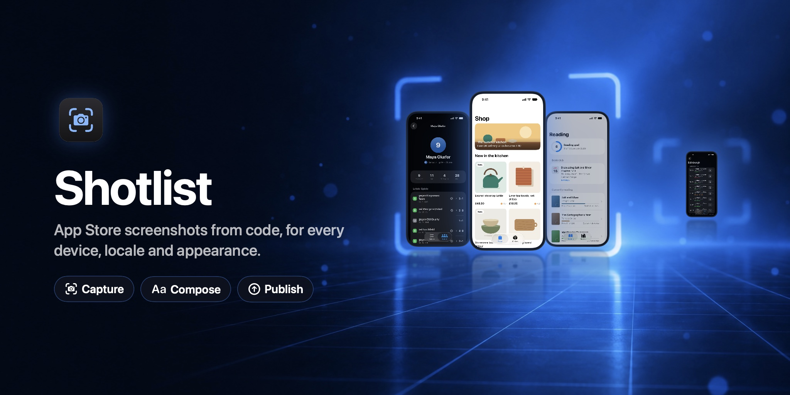

# Shotlist downloads

Signed and notarised builds of **Shotlist**, the Mac app and command-line tool that captures App Store screenshots from code, across every device, locale and appearance, by DigitalHope.

**Get it from [digitalhopeltd.com/shotlist](https://digitalhopeltd.com/shotlist).** Each version is attached to a [release](https://github.com/richiehopedbt/shotlist-releases/releases) with two files:

- `Shotlist-<version>.dmg`, the Mac app, which updates itself from here.
- `shotlist-cli-<version>.zip`, the `shotlist` command-line tool. Unzip it and move `shotlist` somewhere on your `PATH`, such as `/usr/local/bin`.

The [user guide](https://digitalhopeltd.com/shotlist/guide) covers setup, capture, composing and publishing.

## In your app

Your app links [ShotlistKit](https://github.com/richiehopedbt/ShotlistKit), the small open-source package that lets Shotlist show each screen and know when it's ready. Everything in it compiles out of Release builds. With its `@Shot` macro, hosting the scenes is one line:

```swift
import ShotlistMacros
import SwiftUI

@main
@Shot
struct LarderApp: App {
    var root: some View {
        RootView()
    }
}
```

Shotlist is free to download and look around. Capturing, composing and uploading need a subscription, which starts with a free trial.

© DigitalHope Ltd. All rights reserved.
